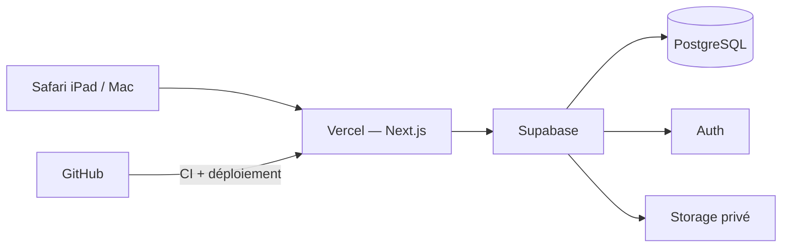

# Architecture — Piano Coach

Source de vérité technique : stack, organisation du code, données, sécurité, déploiement.

## 1. Stack

| Couche | Choix |
|---|---|
| Application | Next.js (App Router) + React + TypeScript strict |
| UI | Tailwind CSS, shadcn/ui, Lucide |
| Données, auth, fichiers | Supabase (PostgreSQL, Auth, Storage privé) via `@supabase/ssr` et `@supabase/supabase-js` |
| Validation | Zod |
| Tests | Vitest (+ Testing Library), Playwright pour l'E2E |
| Outillage | pnpm, Node.js LTS, Supabase CLI (dev), GitHub Actions |
| Hébergement | Vercel Hobby + Supabase Free |

- Versions stables au moment du bootstrap, verrouillées par `pnpm-lock.yaml`. Pas d'API expérimentale sans ADR.
- À n'ajouter que le jour où un écran en a besoin : `recharts` (graphiques), `react-hook-form` (formulaires complexes).
- Interdit sans ADR : Prisma/ORM, second backend, analytics, télémétrie, API d'IA, service payant.



## 2. Organisation du code

```text
src/
  proxy.ts                  # (ex-middleware) rafraîchit la session, redirige vers /connexion
  app/
    (public)/connexion/
    (protected)/            # layout qui exige une session
      page.tsx              # Accueil
      aujourdhui/           # séance du jour ; aujourdhui/seance = saisie des résultats
      programme/            # semaine
      exercices/[slug]/
      repertoire/[id]/      # + nouveau/ ; [id]/partition = redirection vers l'URL signée
      parcours/
      progression/
      parametres/
      export/               # route GET : JSON complet ou CSV de l'historique
  components/               # ui/ (primitives shadcn restylées), layout/, forms/
  features/
    <feature>/              # planner, practice, curriculum, progress, repertoire, profile, auth
      domain/               # fonctions pures, sans Next ni Supabase — testées
      server/               # requêtes + server actions (validation Zod, auth)
      *.tsx                 # composants propres à la feature
  lib/
    supabase/               # client serveur, client navigateur, types générés
    dates/  domain/  validation/
supabase/
  migrations/               # schéma + catalogue de départ
  tests/                    # tests RLS (pgTAP)
e2e/                        # Playwright, contre le Supabase local uniquement
docs/
```

Créer les dossiers au fur et à mesure, pas d'avance.

**Conventions**
- Alias `@/*` → `src/*`. Composants en PascalCase, fonctions en camelCase.
- Un module `server-only` n'est jamais importé par un Client Component.
- Une server action : parse Zod → `supabase.auth.getUser()` → repository → `revalidatePath` → réponse typée `{ ok: true, data } | { ok: false, error }` avec message en français.
- Aucune donnée privée dans un cache partagé : `cacheComponents` est désactivé dans `next.config.ts`, toutes les pages sont rendues à la demande (voir [ADR 0001](adr/0001-choix-techniques-mvp.md)).
- Next.js 16 : lire `node_modules/next/dist/docs/` avant d'utiliser une API ; `middleware` s'appelle désormais `proxy`.

## 3. Modèle de données

Tables personnelles : `user_id uuid not null references auth.users(id)` + RLS. Tables de catalogue : lecture seule pour le client, alimentées par migration/seed.

Valeurs de `domain` : `technique`, `scales_harmony`, `reading_rhythm`, `improvisation`, `repertoire` (voir [PRODUCT.md §4](PRODUCT.md#4-les-5-domaines)).

**Catalogue**

| Table | Colonnes principales |
|---|---|
| `competencies` | `id`, `slug`, `name`, `domain`, `level`, `position`, `description` |
| `exercises` | `id`, `slug`, `title`, `domain`, `level`, `objective`, `instructions`, `estimated_minutes`, `key_signature`, `bpm_target`, `bpm_increment`, `source_type`, `source_url` |
| `exercise_competencies` | `exercise_id`, `competency_id`, `weight` |
| `repertoire_catalog` | `id`, `slug`, `title`, `composer`, `style`, `level`, `tier`, `source_type`, `source_url`, `rights_note` |

`source_type` : `original` · `public_domain` · `reference` · `user_upload`.

**Données personnelles**

| Table | Colonnes principales |
|---|---|
| `profiles` | `id` (= auth.users), `display_name`, `timezone`, `weekday_minutes` (25), `weekend_minutes` (60), `practice_days`, `show_streak`, `domain_preferences jsonb` (0 moins · 1 normal · 2 plus), `self_assessment jsonb` (niveau 1–3 par domaine), `challenge_level` (`gentle`/`balanced`/`ambitious`), `onboarded_at` |
| `user_competencies` | `user_id`, `competency_id`, `status` (`upcoming`/`learning`/`consolidating`/`acquired`), `last_practiced_at` |
| `user_repertoire` | `id`, `user_id`, `catalog_id?`, `title`, `composer`, `style`, `level`, `felt_difficulty`, `tier` (`comfort`/`growth`/`challenge`), `status` (`to_discover`/`active`/`paused`/`completed`), `current_step`, `notes`, `source_url`, `pdf_asset_id?` |
| `practice_plans` | `id`, `user_id`, `week_start`, `planner_version`, `generated_at`, `settings_snapshot jsonb` |
| `planned_tasks` | `id`, `plan_id`, `user_id`, `task_date`, `position`, `domain`, `exercise_id?`, `user_repertoire_id?`, `planned_minutes`, `target_bpm?`, `reason`, `status` (`planned`/`done`/`skipped`), `is_user_modified` |
| `practice_sessions` | une par jour : `id`, `user_id`, `session_date`, `status` (`in_progress`/`completed`), `started_at`, `ended_at`, `actual_minutes` |
| `practice_logs` | `id`, `user_id`, `session_id`, `planned_task_id?`, `domain`, `exercise_id?`, `user_repertoire_id?`, `practiced_at`, `practice_date` (date locale), `actual_minutes`, `bpm?`, `result` (`success`/`retry`) |
| `pdf_assets` | `id`, `user_id`, `storage_path`, `original_filename`, `mime_type`, `size_bytes` |

Règles :
- `planned_tasks` et `practice_logs` référencent exactement un exercice **ou** un morceau (contrainte `CHECK`).
- **Planifié ≠ réalisé** : seuls les `practice_logs` comptent dans les statistiques. Une séance interrompue reste `in_progress` et peut être reprise ; une tâche non faite reste `planned` puis est ignorée.
- Libellés UI : `success` = « Réussi », `retry` = « À retravailler ».

## 4. Planner

- `features/planner/domain/buildPlan(input): PlanDraft` — fonction pure, règles dans [PRODUCT.md §6](PRODUCT.md#6-règles-du-planner).
- `features/planner/server` — charge les données, appelle `buildPlan`, conserve les tâches `is_user_modified`, persiste.
- `planner_version` enregistré avec chaque plan. Pas de cron : le plan est créé à la première visite de la semaine, puis les jours à venir sont réajustés après chaque séance terminée, changement de réglages ou de pièces en cours.
- Jours **verrouillés**, jamais regénérés : le passé, les jours commencés, et les jours modifiés à la main (sauf confirmation explicite).
- La cible BPM et le statut des compétences ne sont pas stockés à part : ils se déduisent des `practice_logs` (`practice/domain/bpm.ts`, `curriculum/domain/competency-status.ts`).

## 5. Sécurité

- Inscription publique désactivée ; un seul compte créé à la main. Connexion email/mot de passe (pas de SMTP tiers requis).
- Sessions en cookies via `@supabase/ssr` ; middleware qui rafraîchit la session et protège `(protected)`.
- Vérifier l'utilisateur côté serveur pour chaque lecture/mutation privée ; `user_id` toujours dérivé de la session.
- RLS activée sur toutes les tables. Personnel : `auth.uid() = user_id` pour SELECT/INSERT/UPDATE/DELETE. Catalogue : SELECT seul.
- `service_role` : jamais dans le navigateur ni dans les routes utilisateur ; uniquement scripts d'admin locaux/CI si nécessaire.

## 6. Stockage PDF

- Bucket privé `personal-scores`. Chemin : `<user_id>/<uuid>.pdf` (nom d'origine conservé seulement en base).
- Policies Storage : le premier segment du chemin doit égaler `auth.uid()`.
- Envoi **direct du navigateur vers Storage** (les fonctions Vercel limitent la taille des requêtes), dans le dossier de l'utilisateur. Type et taille sont imposés par le bucket (`application/pdf`, ≤ 20 Mo), puis une server action revérifie l'objet avant d'enregistrer ses métadonnées.
- Lecture par URL signée générée à la demande (courte durée), jamais stockée.
- Suppression : objet Storage + ligne `pdf_assets`, avec compensation si l'une des deux échoue.

## 7. Environnements et déploiement

**Variables** (`.env.example`)

```dotenv
NEXT_PUBLIC_SUPABASE_URL=
NEXT_PUBLIC_SUPABASE_PUBLISHABLE_KEY=
```

Tout autre secret : serveur/CI uniquement, jamais préfixé `NEXT_PUBLIC_`.

**Local** : `pnpm dev` avec `.env.local`. Supabase local (CLI + Docker) : `pnpm db:start`, puis `pnpm db:reset` pour rejouer les migrations ; requis seulement pour `pnpm test:db` (RLS) et `pnpm test:e2e`.

**Commandes** : `pnpm lint` · `pnpm typecheck` · `pnpm test` (unitaires) · `pnpm test:db` (RLS) · `pnpm test:e2e` (navigateur) · `pnpm build` · `pnpm db:types` (types TypeScript depuis la base locale).

**MCP Supabase** : `.mcp.json` est relié à un projet distant. Les migrations sont écrites en fichiers dans `supabase/migrations/` ; les appliquer au distant uniquement après accord de l'utilisateur.

**Production** : branche `main` → Vercel Hobby, variables dans Vercel, domaine `.vercel.app`. Projet Supabase de prod séparé si le quota gratuit le permet, sinon le documenter.

**Limites du gratuit** : Vercel Hobby = usage personnel ; Supabase Free met en pause les projets inactifs et n'inclut pas de sauvegarde. Donc : export régulier (dump SQL + PDF), restauration testée, réactivation manuelle si pause. Ne pas générer de trafic artificiel. Aucune facturation activée sans accord explicite.

## 8. Portabilité

PostgreSQL standard, migrations SQL, domaine sans dépendance Supabase, repositories pour isoler le fournisseur, fichiers référencés par chemin et non par URL publique.

## Références

[Next.js App Router](https://nextjs.org/docs/app) · [Supabase Auth Next.js](https://supabase.com/docs/guides/auth/quickstarts/nextjs) · [Supabase SSR](https://supabase.com/docs/guides/auth/server-side) · [Storage access control](https://supabase.com/docs/guides/storage/security/access-control) · [Vercel Hobby](https://vercel.com/docs/plans/hobby) · [Supabase pricing](https://supabase.com/pricing)
